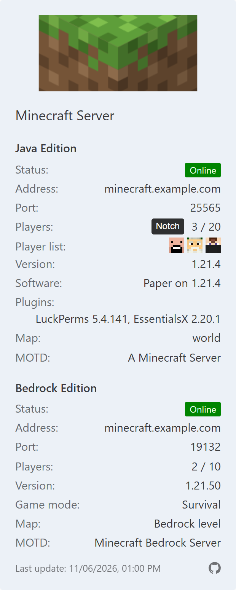

<p align="center">
  
</p>

# mcstatus-httpd

mcstatus-httpd shows any information of a Minecraft Server via HTTP-Server as JSON. 
It uses [mcstatus](https://github.com/py-mine/mcstatus).

Features:
* Minecraft Java Edition and/or Bedrock Edition (a server that is not configured is omitted from the output)
* Java: full player list and plugins via [Query](https://minecraft.wiki/w/Query), automatic fallback to the normal status ping if Query is disabled
* Bedrock: [NetherNet](https://minecraft.wiki/w/NetherNet) (default since Bedrock 1.26.50) and RakNet (legacy), both are tried at the same time by default
* Both servers are queried in parallel, results are cached (protects the Minecraft server)
* Optional player avatars (Java, head or body, flat or 3D), loaded via mcstatus-httpd with cache and provider fallback
* Optional sub path (`HTTP_PREFIX`), e.g. for a reverse proxy
* Optional HTTPS
* Built-in health check command `--healthcheck` for docker-compose (also works with the distroless image)
* Configuration via environment variables and/or command line arguments

## INFO

This is a personal project, made for my own Minecraft servers.  
Feel free to use it :-), but there is no support and no guarantee.  

> [!NOTE]
> This project is developed with AI assistance, all changes are reviewed and tested by me.

## Minecraft Server

I use Minecraft Server with Docker:
* [Minecraft Java Edition](https://github.com/itzg/docker-minecraft-server)
* [Minecraft Bedrock Edition](https://github.com/itzg/docker-minecraft-bedrock-server)

Examples for docker-compose (minecraft.yml, minecraft-bedrock.yml) you can find here: [click](https://github.com/Tob1as/docker-kubernetes-collection/tree/master/examples_docker-compose)

### Requirements

* Python >= 3.12
* [mcstatus](https://github.com/py-mine/mcstatus) >= 14.2.0
* Minecraft Java: [Query](https://minecraft.wiki/w/Query) should be enabled (`enable-query=true` in `server.properties`).  
  Without Query the status ping is used as fallback, which only provides a player *sample* (max. ~12 names) and no plugins and map name.
* Minecraft Bedrock with NetherNet: the server port must be reachable via **TCP** (status via `GET /v1/join`).  
  With RakNet (Bedrock server setting `transport=raknet`): the server port must be reachable via **UDP**.

## Configuration

Every setting can be set as environment variable or as command line argument (arguments take precedence). See `python3 mcstatus-httpd.py --help`.

| Environment variable                 | Argument              | Default                 | Description |
|--------------------------------------|-----------------------|-------------------------|-------------|
| `MINECRAFT_JAVA_SERVER`              | `--java-server`       | (disabled)              | Java server address |
| `MINECRAFT_JAVA_SERVER_PORT`         | `--java-port`         | `25565`                 | Java game port (TCP) |
| `MINECRAFT_JAVA_SERVER_PORT_QUERY`   | `--java-query-port`   | same as game port       | Java query port (UDP) |
| `MINECRAFT_JAVA_SERVER_OVERWRITE`    | `--java-overwrite`    | same as server          | Hostname shown in the output |
| `MINECRAFT_BEDROCK_SERVER`           | `--bedrock-server`    | (disabled)              | Bedrock server address |
| `MINECRAFT_BEDROCK_SERVER_PORT`      | `--bedrock-port`      | `19132`                 | Bedrock game port (NetherNet: TCP, RakNet: UDP) |
| `MINECRAFT_BEDROCK_SERVER_OVERWRITE` | `--bedrock-overwrite` | same as server          | Hostname shown in the output |
| `MINECRAFT_BEDROCK_TRANSPORT`        | `--bedrock-transport` | `auto`                  | `nethernet` (TCP, default since Bedrock 1.26.50), `raknet` (UDP, legacy) or `auto` (both at the same time) |
| `MINECRAFT_TIMEOUT`                  | `--timeout`           | `3`                     | Seconds until a server counts as offline |
| `CACHE_TTL`                          | `--cache-ttl`         | `10`                    | Seconds a result is reused, `0` = query on every request |
| `HTTP_HOST`                          | `--http-host`         | `0.0.0.0`               | Listen address, `0.0.0.0` = IPv4 only, `::` = IPv4 + IPv6 |
| `HTTP_PORT`                          | `--http-port`         | `8080`                  | Listen port |
| `HTTP_PREFIX`                        | `--http-prefix`       | (none)                  | Sub path, e.g. `mcstatus` → `/mcstatus` |
| `HTTP_CORS_ORIGIN`                   | `--http-cors-origin`  | `*` (all)               | Websites allowed to load the status (CORS), e.g. `https://forum.example.com,https://example.com` |
| `HTTP_TRUSTED_PROXIES`               | `--http-trusted-proxies` | (none)               | Reverse proxies (IPs/networks, e.g. `172.18.0.0/16`) whose `X-Forwarded-For`/`X-Real-IP` header is used for the client IP in the log |
| `HTTPD_SSL_ENABLE`                   | `--ssl` / `--no-ssl`  | `0`                     | Enable HTTPS (`1`/`true`/`yes`/`on`) |
| `SSL_CERTFILE`                       | `--ssl-certfile`      | `ssl.crt`               | TLS certificate file |
| `SSL_KEYFILE`                        | `--ssl-keyfile`       | `ssl.key`               | TLS private key file |
| `AVATAR_ENABLE`                      | `--avatar` / `--no-avatar` | `0`                | Player avatars (Java), see [Player avatars](#player-avatars) |
| `AVATAR_TYPE`                        | `--avatar-type`       | `head`                  | Default type: `head`, `body`, `head3d` or `body3d` |
| `AVATAR_IMAGE_SIZE`                  | `--avatar-image-size` | `64`                    | Default image width in pixels requested from the providers (`8`-`300`), body images are twice as high |
| `AVATAR_ALLOWED_TYPES`               | `--avatar-allowed-types` | `head,body,head3d,body3d` | Types that can be requested with `?type=` (the default type is always allowed) |
| `AVATAR_ALLOWED_SIZES`               | `--avatar-allowed-sizes` | `16,32,48,64,96,128,192,256,300` | Sizes that can be requested with `?size=` (`8`-`300`, the default size is always allowed) |
| `AVATAR_PROVIDERS`                   | `--avatar-providers`  | `mc-heads,minotar,crafthead` | Avatar providers in order of preference (fallback), built-in names or own URL templates |
| `AVATAR_CACHE_TTL`                   | `--avatar-cache-ttl`  | `3600`                  | Seconds an avatar is used before it is loaded again (the old one is kept if loading fails) |
| `AVATAR_CACHE_TYPE`                  | `--avatar-cache-type` | `memory`                | `memory` (lost on restart) or `file` |
| `AVATAR_CACHE_DIR`                   | `--avatar-cache-dir`  | `/tmp/mcstatus-httpd/avatars` | Directory of the file cache |
| `AVATAR_CACHE_MAX_ENTRIES`           | `--avatar-cache-max-entries` | `500`            | Maximum number of cached avatars (every type and size counts), `0` = unlimited |
| `AVATAR_TLS_VERIFY`                  | `--[no-]avatar-tls-verify` | `1`                | `0` = accept self-signed HTTPS certificates of own URL templates (built-in providers are always verified) |
| `AVATAR_ONLINE_ONLY`                 | `--[no-]avatar-online-only` | `1`               | Only serve avatars of online players, `0` = any valid player name (see below) |
| `AVATAR_TYPE_FALLBACK`               | `--[no-]avatar-type-fallback` | `1`             | Serve the flat avatar if a 3D avatar is not available (`head3d` → `head`, `body3d` → `body`) |
| `PLAYER_UUID_LOOKUP`                 | `--[no-]player-uuid-lookup` | `1`               | Look up the UUID of a player for the avatar providers, `0` = always use the name, see [Player UUIDs](#player-uuids) |
| `PLAYER_UUID_PROVIDERS`              | `--player-uuid-providers` | `mojang,minecraftservices,playerdb,minetools` | UUID lookup services in order of preference (fallback) |
| `PLAYER_UUID_CACHE_TTL`              | `--player-uuid-cache-ttl` | `86400`             | Seconds a UUID is used before it is looked up again (the old one is kept if that fails) |
| `PLAYER_UUID_CACHE_TYPE`             | `--player-uuid-cache-type` | `memory`           | `memory` (lost on restart) or `file` |
| `PLAYER_UUID_CACHE_FILE`             | `--player-uuid-cache-file` | `/tmp/mcstatus-httpd/uuids.json` | JSON file of the UUID cache |
| `PLAYER_UUID_CACHE_MAX_ENTRIES`      | `--player-uuid-cache-max-entries` | `1000`      | Maximum number of cached UUIDs, `0` = unlimited |
| `LOGLEVEL`                           | `--loglevel`          | `INFO`                  | `DEBUG`, `INFO`, `WARNING`, `ERROR`, `CRITICAL` |

At least one server (Java or Bedrock) must be configured.  
With HTTPS enabled, `HTTP_PORT` only serves HTTPS (no plain HTTP), e.g. use `HTTP_PORT=8443`.  
If HTTPS is enabled but the certificate files are missing, the service does not start.

IPv4 + IPv6 behind a reverse proxy (e.g. Docker network with `--ipv6`):

```yml
      HTTP_HOST: "::"
      HTTP_TRUSTED_PROXIES: "172.18.0.0/16, 10.0.0.5, fd00:dead:beef::/48, ::1"
```

`HTTP_TRUSTED_PROXIES` accepts any number of IPv4/IPv6 networks and single addresses (comma separated).  
Only for requests from these proxies the client IP is taken from `X-Forwarded-For`/`X-Real-IP` (shown in the log with `LOGLEVEL=DEBUG`).

## Endpoints

| Without prefix   | With `HTTP_PREFIX=mcstatus` | Description |
|------------------|-----------------------------|-------------|
| `/`              | `/mcstatus`                 | Minecraft server status (JSON) |
| `/healthcheck`   | `/mcstatus/healthcheck`     | Health check of this service (JSON) |
|                  | `/healthcheck`              | Health check, always available without prefix |
| `/avatar/<name>` | `/mcstatus/avatar/<name>`   | Avatar of a Java player who is online (PNG, any name with `AVATAR_ONLINE_ONLY=0`), optional `?type=body&size=128`, only with `AVATAR_ENABLE` |

`GET` and `HEAD` are supported, a trailing slash and query strings (e.g. `?_=123`) are ignored (except `type` and `size` of the avatar endpoint).  
The status endpoint always answers with HTTP 200, an unreachable server is shown with `"online": false`.

## Player avatars

With `AVATAR_ENABLE=1` the website examples show avatars instead of the names of Java players (Bedrock provides no player names).  
The name is shown as tooltip on mouse over and on tap.

* The avatars are loaded **by mcstatus-httpd** and cached, visitors only talk to your server. The avatar providers never see the IP addresses of your visitors.
* Only players who are currently online are served, other names return 404.  
  With `AVATAR_ONLINE_ONLY=0` any valid Java player name is served, e.g. as profile picture in your forum. Be aware that anybody can then use your service as avatar proxy: random names can push your players out of the cache, delay avatar downloads and cause rate limits at the providers.
* `AVATAR_TYPE`: default type:
  * `head`: flat head with helm (e.g. 64x64 px)
  * `body`: flat front view with the outer skin layer (e.g. 64x128 px)
  * `head3d`: isometric head **without** helm, facing right (e.g. 57x60 px, size and perspective differ a little by provider)
  * `body3d`: isometric body, facing right (e.g. 64x154 px), only provided by `mc-heads`

  All providers deliver the same images for `head` and `body`. `head3d` is without helm, because `minotar` and `crafthead` have no 3D head with helm.

  If no provider delivers a 3D avatar and none is cached (e.g. `mc-heads` is down, the only provider of `body3d`), the flat avatar is served instead (`head3d` → `head`, `body3d` → `body`), so a website shows an avatar and not the name. The replacement is only cached by the browser for 5 minutes, the 3D avatar is tried again after that. The response header `X-Avatar-Type` shows the delivered type. Disable with `AVATAR_TYPE_FALLBACK=0`.
* `AVATAR_IMAGE_SIZE`: default image width loaded from the providers (`{size}` in URL templates). The website examples show the avatars in their own size (`AVATAR_SIZE` in the HTML) and scale them sharp (pixel art), so 64 is enough for most pages. Own URL templates without `{size}` always deliver their own size.
* Type and size can be chosen per request, other values return 400:
  ```
  /avatar/Notch                        -> AVATAR_TYPE, AVATAR_IMAGE_SIZE
  /avatar/Notch.png?type=body&size=128 -> body, 128x256 px
  ```
  Allowed are the values of `AVATAR_ALLOWED_TYPES` and `AVATAR_ALLOWED_SIZES` (a fixed list, so the number of cached variants stays small).
* `AVATAR_PROVIDERS`: providers in order of preference. If a provider fails (timeout, error, rate limit), the next one is used and the failing one is paused for a while (rate limits: as long as the provider asks for via `Retry-After`).
  * Built-in: `mc-heads` ([mc-heads.net](https://mc-heads.net/), all types), `minotar` ([minotar.net](https://minotar.net/)) and `crafthead` ([crafthead.net](https://crafthead.net/)), both all types except `body3d`. All are called with the UUID of the player (see [Player UUIDs](#player-uuids)). A provider without the requested type is skipped.
  * Own URL templates with `{name}` (player name) or `{id}` (UUID, or the name if unknown) and optional `{size}`, e.g. of a server plugin (must deliver PNG). A template is used for the default type, or with a prefix like `head=` or `body3d=` for this type:
    ```yml
    AVATAR_PROVIDERS: "head=http://minecraft:8100/tiles/faces/32x32/{name}.png, mc-heads, minotar, crafthead"
    ```
    If the plugin uses HTTPS with a self-signed certificate, set `AVATAR_TLS_VERIFY: 0` (only for own URL templates, prefer `http://` inside a Docker network).
* Every Java account has a skin (the default skins Steve, Alex etc. if none was chosen). Names without Mojang account (offline-mode servers, Geyser/Floodgate players like `.Name`, `Anonymous Player` of hidden player lists):
  * `mc-heads` and `crafthead` deliver the default head (Steve), `minotar` answers 404 and the next provider is tried.
  * Names that are no valid Java names (e.g. `.Name`) are not requested at all.
  * If no provider has an avatar, the website shows the name as text, so every player is listed.
* Cache:
  * Avatars are loaded when they are requested (not on status requests) and used for `AVATAR_CACHE_TTL` seconds. After that the next request loads it again from the providers. If none of them delivers it, the old avatar is kept and used (next attempt after 5 minutes).
  * `AVATAR_CACHE_TYPE=memory` (default): in memory, lost on restart.
  * `AVATAR_CACHE_TYPE=file`: PNG files in `AVATAR_CACHE_DIR` (`<type>/<size>/<name>.png`), kept across restarts. Without a volume the files are kept on `docker restart`, but lost when the container is recreated (e.g. image update). To keep them, mount a volume (here together with the UUID cache, see [Player UUIDs](#player-uuids)):
    ```yml
        environment:
          AVATAR_CACHE_TYPE: file
          PLAYER_UUID_CACHE_TYPE: file
        volumes:
          - mcstatus-cache:/tmp/mcstatus-httpd
    ```
    A named volume gets the right owner automatically. A bind mount (host directory) must be writable for the user of the container (distroless: UID `65532`, alpine: `nobody` = UID `65534`). With `read_only: true` use a volume or `tmpfs` for the directory.
  * `AVATAR_CACHE_MAX_ENTRIES`: the least recently used avatars are removed above the limit (every type and size counts). `0` = unlimited, recommended only with `AVATAR_ONLINE_ONLY=1`: with any name allowed, random names (mc-heads delivers the default skin for every name) can fill the cache.

### Player UUIDs

The avatar providers recommend UUIDs instead of names (names are slower and more likely to be rate limited). mcstatus-httpd looks up the UUID of a player by name when an avatar is loaded (only if a provider uses `{id}`, the built-in providers do):

* `PLAYER_UUID_PROVIDERS`: lookup services in order of preference. If a service fails (timeout, error, rate limit), the next one is used and the failing one is paused for a while.
  * `mojang`: [api.mojang.com](https://minecraft.wiki/w/Mojang_API)
  * `minecraftservices`: api.minecraftservices.com (also Mojang, other server)
  * `playerdb`: [playerdb.co](https://playerdb.co/)
  * `minetools`: [api.minetools.eu](https://api.minetools.eu/)
* If a service does not know the name (no Mojang account) or no service answers, the name is used instead, so the avatar providers still get a request.
* UUIDs are cached for `PLAYER_UUID_CACHE_TTL` seconds (unknown names at most 1 hour). After that the next avatar download looks it up again, if that fails the old UUID is kept.
* `PLAYER_UUID_CACHE_TYPE=file` keeps the UUIDs across restarts in `PLAYER_UUID_CACHE_FILE` (JSON), see the volume example above.
* `PLAYER_UUID_LOOKUP=0` disables the lookup, `{id}` is then always the name.
* The avatar cache files are named by player name, they do not change.

## Website examples

* [examples/index.html](examples/index.html): status page for any website (same box code as the wsc-box, incl. the needed CSS), neutral gray design with automatic dark mode
* [examples/wsc-box.html](examples/wsc-box.html): status box for [WoltLab Suite (Core)](https://www.woltlab.com/) (short: WSC) (ACP → Appearance → Boxes → box type "HTML" [*](https://manual.woltlab.com/en/boxes/)), shows status, players, version, MOTD etc. Remove the lines you do not need.
* [examples/wsc-box-mini.html](examples/wsc-box-mini.html): compact box like "Who is online": status dot, players online / max, the Java player list and the time of the last update. Mouse over shows the status text, address and player names. With only one server its address replaces the server name.
* [examples/simple.html](examples/simple.html): minimal example (plain text, no design, short code for beginners): address, online/offline, players online / max and player names.

The boxes adapt to their own width: in a narrow place (sidebar, phone) Java and Bedrock are shown below each other, in a wide place (footer, own page) side by side.

Icons in [examples/icons](examples/icons/) (own drawing, generated by [tools/make-icons.mjs](tools/make-icons.mjs), same license as this project): Minecraft block as SVG and PNG (`minecraft-block-icon-<size>.png`, 16 to 512 px, e.g. as box icon or favicon) and status icons (`status-dot-green.svg`, `status-dot-red.svg`, `status-dot-mixed.svg`, each also as `-plain.svg` without the light ring) and `plus.svg`.

The WSC box in a forum sidebar (with player avatars, the name is shown on mouse over):



Tip: Serve mcstatus-httpd on the same domain as your website via reverse proxy and `HTTP_PREFIX` (e.g. `https://example.com/mcstatus`).  
A website served via HTTPS cannot load data from a plain `http://` URL.  
On a different domain this works too (CORS), by default every website is allowed, see `HTTP_CORS_ORIGIN` to restrict it.  
Settings at the top of the script: `MCSTATUS_URL`, `REFRESH_SECONDS`, `DATE_FORMAT` (`''` = page/browser language, e.g. `de-DE` or `iso`), `LANGUAGE`, `SHOW_AVATARS`, `AVATAR_TYPE` (`''` = default of mcstatus-httpd, `head`, `body`, `head3d` or `body3d`), `AVATAR_SIZE` (height of a head in px, default `20`) and `TEXTS`.

Languages: the boxes are in English and German. The language is chosen automatically: the language of the page (`<html lang>`, in WSC the language of the user), on pages without it the language of the browser, otherwise English. `LANGUAGE = 'de'` sets a fixed language. To add a language, copy the `en` block of `TEXTS` in the script (e.g. as `es`) and translate it.

## Use

with docker-compose (see [docker-compose.yml](docker-compose.yml)):  
```yml
services:

  mcstatus-httpd:
    image: ghcr.io/tob1as/mcstatus-httpd:latest
    container_name: mcstatus-httpd
    restart: unless-stopped
    ports:
      - 8080:8080/tcp
    environment:
      #TZ: Europe/Berlin
      # Demo servers of https://mcstatus.io - replace with your own servers.
      MINECRAFT_JAVA_SERVER: demo.mcstatus.io
      MINECRAFT_JAVA_SERVER_PORT: 25565
      #MINECRAFT_JAVA_SERVER_PORT_QUERY: 25565  # set, if UDP (query) is not equal to TCP port
      #MINECRAFT_JAVA_SERVER_OVERWRITE: minecraft.example.com
      MINECRAFT_BEDROCK_SERVER: demo.mcstatus.io
      MINECRAFT_BEDROCK_SERVER_PORT: 19132
      #MINECRAFT_BEDROCK_SERVER_OVERWRITE: minecraft-bedrock.example.com
      #MINECRAFT_BEDROCK_TRANSPORT: auto  # nethernet, raknet or auto
      #HTTP_PREFIX: mcstatus
      #AVATAR_ENABLE: 1                   # player avatars (Java), see "Player avatars"
    healthcheck:
      test: ["CMD", "/venv/bin/python3", "/app/mcstatus-httpd.py", "--healthcheck"]
      interval: 60s
      timeout: 5s
      start_period: 10s
      retries: 3
```

The health check uses `python3 mcstatus-httpd.py --healthcheck` (available since version 2), so no `wget`/`curl` is needed (works with the distroless image).  
For the alpine image use `/usr/local/bin/python3` instead of `/venv/bin/python3`.

local:
* install: `pip3 install -r requirements.txt`
* set variables/env or use arguments
* start: `python3 -u ./mcstatus-httpd.py --java-server demo.mcstatus.io --bedrock-server demo.mcstatus.io`

### Build

```sh
docker build --target=production --build-arg VERSION="$(date -u +'%Y%m%d-%H%M%S').$(git rev-parse --short HEAD)" -t ghcr.io/tob1as/mcstatus-httpd:latest -f Dockerfile .
```

The build argument `VERSION` is shown by `--version`, `/healthcheck` and in the logs (env `MCSTATUS_HTTPD_VERSION` in the image), without it the version is `dev`.

### Releases & Docker image tags

The GitHub workflow builds the Docker image (`ghcr.io/tob1as/mcstatus-httpd`):

| Trigger                                       | Version                        | Image tags |
|-----------------------------------------------|--------------------------------|------------|
| Push of a version tag, e.g. `v2.0.0`          | `2.0.0`                        | `2.0.0`, `2.0`, `2`, `latest`, `<build date>.<commit hash>`, `<commit hash>` |
| Manual start in the GitHub GUI or schedule    | `<build date>.<commit hash>`   | `dev`, `<build date>.<commit hash>`, `<commit hash>` |

A version tag additionally creates a GitHub release with `mcstatus-httpd-<version>.zip` and `.tar.gz` (script, `requirements.txt`, `README.md`, `LICENSE` and the website examples `examples/*.html`).  
Pre-releases like `v2.0.0-rc1` only get the tag `2.0.0-rc1` and are marked as pre-release.

```sh
git tag v2.0.0
git push origin v2.0.0
```

### Development

* [tests/website](tests/website/README.md): test environment for the website examples (only Docker needed), start with `docker compose -f tests/website/docker-compose.yml up -d --build` and open http://localhost:18092/. Shows `index.html`, `simple.html`, `wsc-box.html` and `wsc-box-mini.html` with:
  * live data of the demo servers (mcstatus-httpd built from the current code)
  * mock data: random values on every request, or fixed scenarios like many players, Java without Query (player sample only), offline server, only one server, long names and addresses, HTTP error. Own scenarios are simple JSON files.
  * an avatar check: all avatar variants of the providers for one player side by side
  * a WSC test page: the WSC boxes in the sidebar, in the footer or as own page in the look of a WSC forum (light and dark)

  The files in `examples/` are used directly, a change is visible after reloading the page.
* [tools](tools/README.md): helper scripts (Node.js >= 22 and Chrome, Chromium or Edge, no npm packages):
  * `make-icons.mjs`: generates the icons of `examples/icons` (SVG, optionally PNG and WebP)
  * `screenshot.mjs`: screenshot of a page or of a single status box (e.g. for the README), optionally dark mode, mouse over, only one server and anonymized address, players and MOTD
  * `wsc-styles.mjs`: measures the styles of a WSC page (for the WSC test page)

## Example Output

URL: `http://localhost:8080`

```json
{
	"date": "2026-01-01T12:00:00+00:00",
	"java": {
		"hostname": "minecraft.example.com",
		"port": 25565,
		"online": true,
		"software": {
			"version": "1.21.4",
			"brand": "Paper on 1.21.4",
			"plugins": ["LuckPerms 5.4.141", "EssentialsX 2.20.1"]
		},
		"players": {
			"online": 3,
			"max": 20,
			"list": ["Player1", "Player2", "Player3"]
		},
		"map": "world",
		"motd": "A Minecraft Server"
	},
	"bedrock": {
		"hostname": "minecraft-bedrock.example.com",
		"port": 19132,
		"online": true,
		"software": {
			"version": "1.21.50",
			"brand": "MCPE",
			"protocol": 766
		},
		"players": {
			"online": 0,
			"max": 20
		},
		"map": "Bedrock level",
		"motd": "Minecraft Bedrock Server",
		"gamemode": "Survival"
	}
}
```

* `date` is the time of the query (UTC, ISO 8601). With caching, multiple requests can return the same value.
* `motd` is plain text (formatting codes removed).
* Java without Query (status fallback): `brand` and `map` are `null`, `plugins` is empty and `list` only contains the player sample.
* Bedrock via NetherNet: `brand` is `null` (not provided by NetherNet), `motd` is the server name.

Unreachable server:

```json
{
	"date": "2026-01-01T12:00:00+00:00",
	"java": {
		"hostname": "minecraft.example.com",
		"port": 25565,
		"online": false,
		"error": "Server unreachable"
	}
}
```

Health check (`/healthcheck`):

```json
{"status": "ok", "timestamp": "2026-01-01T12:00:00+00:00", "version": "20260101120000.a1b2c3d4", "sourcecode": "https://github.com/Tob1as/mcstatus-httpd"}
```

### Changes to version 1.x

* `date` is now ISO 8601 in UTC (before: local time `YYYY-MM-DD HH:MM:SS`)
* `plugins` and `players.list` are JSON arrays (before: comma separated string)
* `motd` is plain text (before: raw text with `§` formatting codes)
* New field `online`, unreachable servers no longer break the response
* `/healthcheck` returns JSON (before: empty `text/plain`), unknown paths return 404
* Bedrock: support for NetherNet (`MINECRAFT_BEDROCK_TRANSPORT`), `brand` is `null` via NetherNet
* Command line arguments and new settings (cache, timeout, prefix, CORS, proxies, certificate files)
* HTTPS without certificate files: the service does not start (before: plain HTTP)
* New: `--healthcheck`, `--version`, player avatars (`AVATAR_ENABLE`)
* New: website examples (`examples/`, before `example.html`), icons, test environment and tools
